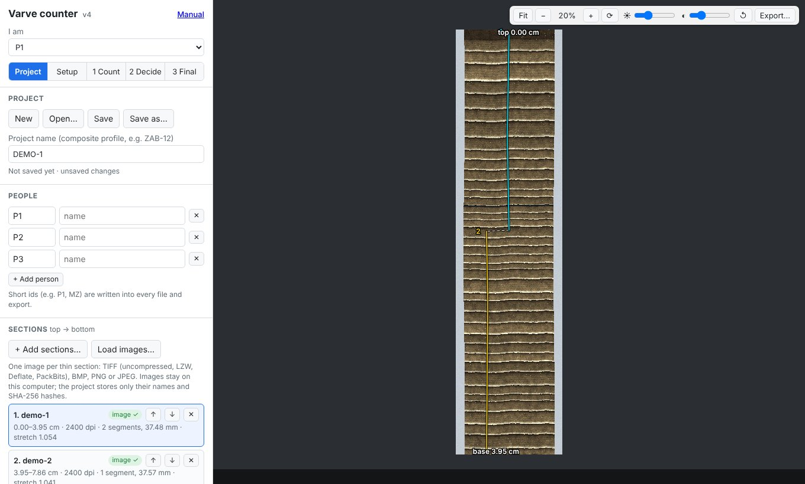
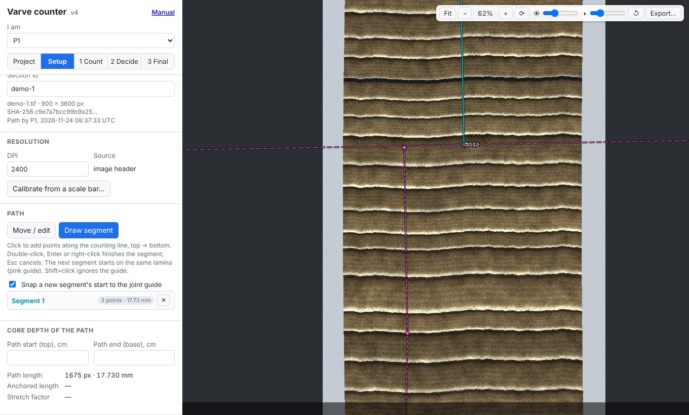
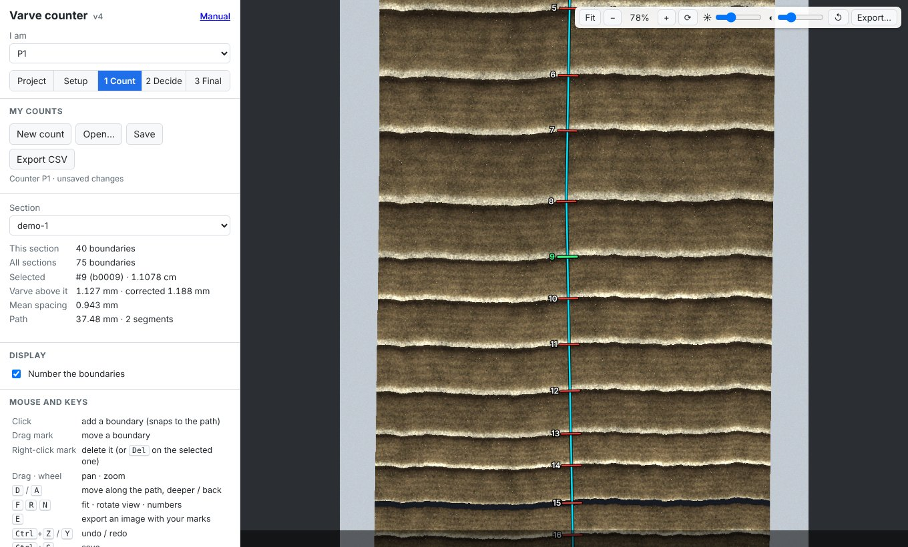
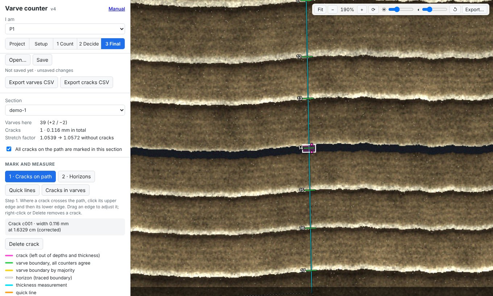
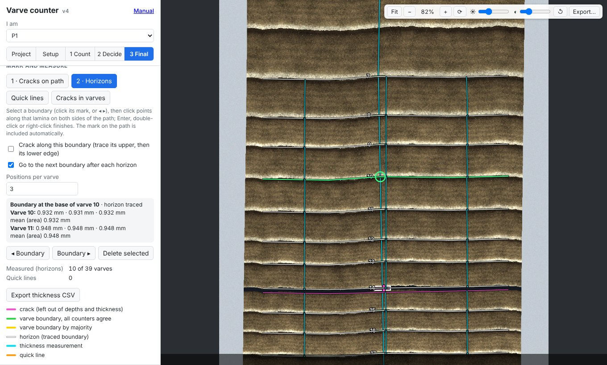
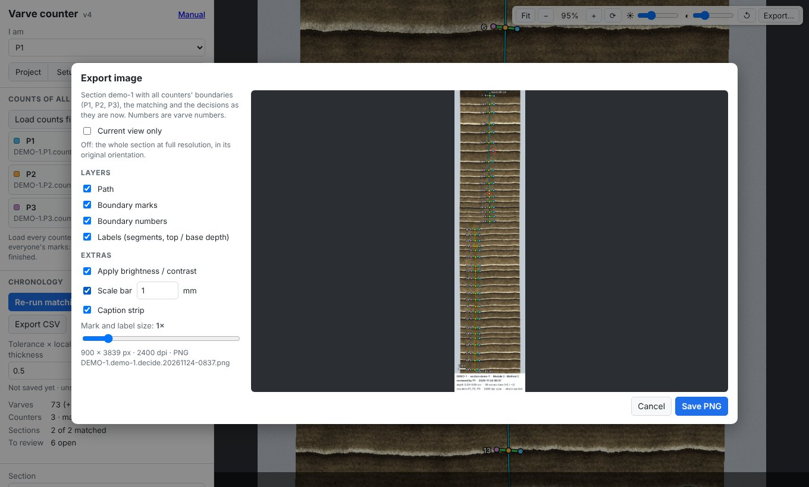

# Varve counter — manual

A complete guide from an empty folder to a varve chronology with uncertainties, final depths
and varve thicknesses. It covers how to work together with coauthors and why the tool works
the way it does. The technical design is in [DESIGN.md](DESIGN.md); a short overview is in
[README.md](README.md).

**Contents**

1. [What the tool does](#1-what-the-tool-does)
2. [Before you start](#2-before-you-start)
3. [Key ideas in five minutes](#3-key-ideas-in-five-minutes)
4. [Step A — Create the project](#4-step-a--create-the-project)
5. [Step B — Set up each section](#5-step-b--set-up-each-section)
6. [Step C — Count (Module 1)](#6-step-c--count-module-1)
7. [Step D — Decide the varves (Module 2, Method C)](#7-step-d--decide-the-varves-module-2-method-c)
8. [Step E — Final depths (Module 3, step 1)](#8-step-e--final-depths-module-3-step-1)
9. [Step F — Varve thickness (Module 3, step 2)](#9-step-f--varve-thickness-module-3-step-2)
10. [Exporting images](#10-exporting-images)
11. [The output files and how to use them](#11-the-output-files-and-how-to-use-them)
12. [Working with coauthors: sharing and portability](#12-working-with-coauthors-sharing-and-portability)
13. [Why it works this way](#13-why-it-works-this-way)
14. [Troubleshooting](#14-troubleshooting)
15. [Keyboard and mouse reference](#15-keyboard-and-mouse-reference)
16. [References](#16-references)

---

## 1. What the tool does

You count varve boundaries on scanned thin sections. Several people count the same sections
independently. The tool then:

- matches their boundaries and decides which ones are varves, following **Method C**: three
  independent counts, every varve decided by agreement (Bonk et al. 2015), compared with other
  counting strategies by Żarczyński, Tylmann & Goslar (2018) — see [References](#16-references);
- gives each varve a core depth in the composite profile, with cracks left out;
- measures varve thickness across the width of the section.

```
 Step A  Project       people, sections (one image per thin section)
 Step B  Setup         DPI, counting path, core depths            → project file
 Step C  1 Count       each counter, blind                        → one counts file per person
 Step D  2 Decide      match counts, majority rule, review        → chronology file
 Step E  3 Final (1)   cracks on the path → final varve depths    → Module 3 file, varves.csv
 Step F  3 Final (2)   horizons → varve thickness                 → thickness.csv
```

Typical roles:

| Role | Does | Writes |
|---|---|---|
| **Project lead** (one person) | Steps A, B, D, E, F | project file, chronology, Module 3 file |
| **Counter** (usually three people, the lead can be one of them) | Step C | own counts file |

---

## 2. Before you start

**Software.** Only a web browser. The whole tool is one file, `index.html`; double-click it
and it opens. Nothing is installed and nothing is uploaded: images and data stay on your
computer, and the tool works offline.

- **Chrome or Edge are recommended.** They can save a file back to where it came from
  (“save in place”). Firefox and Safari work too, but every save becomes a download that you
  move into the project folder yourself.

**Images.** One scan per thin section, **vertical**: the top of the thin section at the top
of the image, depth running down, laminae running across. If a scanner saved a section
sideways or upside down, rotate the image file **before** adding it to a project (afterwards
the file must not change, see 12.4). The tool's *rotate view* button only turns the display.

- Formats: TIFF (uncompressed, LZW, Deflate or PackBits; 8 or 16 bit; strips or tiles),
  BMP, PNG, JPEG.
- Not supported: JPEG-compressed TIFF, BigTIFF, floating-point TIFF. Re-save such files as
  uncompressed or LZW TIFF **before** you start (see 12.4 — images must not change later).
- Size: a 10 cm thin section at 2400 DPI (about 9,500 × 1,900 px) is easy. Very large
  stitched scans (over about 20,000 px on a side) may exceed browser limits.
- Scan resolution (DPI) is read from the file. Write it down from the scanner settings
  anyway: scanners often store a wrong or default value.

**What you need to know about the core.** For each thin section, the core depth (in the
composite profile) where your counting line starts and ends. Section 5.3 explains how to
choose these.

**Suggested folder.** Put everything of one profile in one folder (details in 12.1):

```
ZAB-12/
  index.html                     ← the tool (a copy, so everyone uses the same version)
  manual.html                    ← this manual (opened by the tool's “Manual” link)
  images/                        ← the thin-section scans, never edited
  ZAB-12.project.json
  counts/                        ← one file per counter
  ZAB-12.chronology.json
  ZAB-12.thickness.json
  exports/                       ← CSV and PNG exports
```

---

## 3. Key ideas in five minutes

- **Project.** One composite sediment profile, e.g. `ZAB-12`. Its name is part of every
  file name and is how files recognise each other.
- **Section.** One thin section = one image, vertical (top of the section at the top of the
  image). Sections are ordered from top to bottom.
- **Path.** The counting line drawn on a section. It can be made of several **segments**
  (to step around a disturbance); they are joined into one length.
- **s.** Position along the path, from its start.
- **Depth anchors.** The core depth of the path start (top) and end (base). Every point on
  the path gets a core depth by linear interpolation between them; this corrects shrinkage
  of the thin section and small correlation errors.
- **Boundary.** One click = one varve boundary. A boundary is the **base of the varve above
  it**, i.e. the point where that varve year begins (for example, the start of the spring
  calcite lamina on top of the previous winter layer).
- **Counting goes from the top down.** Varve 1 is the youngest varve, at the top of the
  record (the year of coring, possibly incomplete). The partial varve below the last
  boundary at the base of the record is not counted.
- **Varve numbers only.** The tool never assigns calendar years. Anchoring to the coring
  year, a tephra or radiocarbon is done later (e.g. in R). Floating chronologies need no
  special treatment.
- **People** have short ids (`P1`, `MZ`, …) that appear in all files and exports.

---

## 4. Step A — Create the project

1. Open `index.html`.
2. **Project → New**, enter the profile name (e.g. `ZAB-12`).
   - Choose it carefully: counts and chronology files check that they belong to this exact
     name. Renaming later separates the project from files made with the old name.
3. **People → + Add person** for everyone who will count or work on the project. Give short,
   stable ids; names are optional.
   - Ids end up in file names and exports. Use letters, digits, `-` or `_`.
4. **I am** (top of the panel): choose yourself. The browser remembers this per project.
5. **+ Add sections…**: choose all thin-section images at once.
   - Each image becomes a section named after the file (you can rename it in Setup).
   - Order them **top to bottom** with ↑ ↓.
   - The project stores each image's name and its **SHA-256 hash** (a fingerprint of the
     file's content), not the image itself.
6. **Save** → `ZAB-12.project.json`.



> **Why images are not stored in the project:** a project file of a few kB is easy to send
> and version; scans are hundreds of MB. The hash guarantees that everybody works on exactly
> the same image, whatever the file is called on their computer.

---

## 5. Step B — Set up each section

Done once, by one person, in the **Setup** tab. Choose the section at the top of the tab.

### 5.1 Resolution (DPI)

- **DPI** shows the value read from the image and its source (*image header*).
- If it is wrong or missing, type the correct value (*entered by hand*).
- Or **Calibrate from a scale bar…**: click both ends of a scale bar visible on the scan,
  type its length in mm, **Apply** (*scale bar*).

> **Why it matters:** DPI converts pixels to millimetres for thicknesses and positions. Core
> depths come from the depth anchors (5.3), so a slightly wrong DPI does not shift depths,
> but it does change thicknesses. The **stretch factor** (5.3) is your check.

### 5.2 The counting path

1. **Draw segment.** Click points along the line on which you want varves to be counted,
   **from top to bottom** of the section, i.e. down the image. Finish with **Enter**, a **double-click** or a
   **right-click**. **Esc** cancels.
2. Choose the line where lamination is clearest and most continuous. It does not have to be
   straight; add points to follow it.
3. **More segments** (to step around a disturbance, a burrow, a bad patch): draw the next
   segment the same way. It must start **on the same lamina** where the previous segment
   ended, only shifted sideways.
   - A pink **joint guide** runs through the end of the previous segment, across the path,
     roughly along that lamina. The first click of the new segment snaps onto it. Check that
     the guide really follows the lamina; hold **Shift** while clicking to place the start
     freely.
   - Segments are joined into one length: the first segment covers `s = 0 … L1`, the second
     `L1 … L1+L2`, and so on.
4. **Move / edit** mode: drag a point to move it; right-click or **Delete** removes it.
   The segment list on the left can delete whole segments.



> **Why joints must be on the same lamina:** the joined path is one continuous axis of
> depth. If the second segment started on a different lamina, the varves in between would be
> skipped or counted twice.
>
> **Ownership rule:** a segment owns its start but not its end. A boundary exactly on a joint
> is counted once, in the following segment.

### 5.3 Core depth of the path

Enter **Path start (top)** and **Path end (base)** in cm of composite core depth.

- Usually you determine these from the correlation of the thin section with the core (e.g.
  marker layers, the position of the thin-section box in the core).
- **The path end of a section must equal the path start of the next one.** When you enter a
  base depth, the next section's empty top depth is filled with the same value. The Project
  tab shows a green message when depths are continuous, or the gap/overlap that must be
  fixed.
- Because thin sections overlap (typically by about 2 cm), choose the joint so that the
  path of section *n* ends exactly on the lamina where the path of section *n+1* starts.
  Then no varve is counted twice or skipped.

The panel shows the **stretch factor** = depth interval ÷ path length in mm. Values near 1
are normal (slightly above 1 when the thin section shrank). Values far from 1 (the tool warns
beyond ±15 %) usually mean a wrong DPI or wrong depths.

> **Why linear interpolation between two anchors:** it spreads the difference between the
> thin section and the core evenly over the section, so errors do not accumulate from one
> section to the next. Cracks are corrected separately and later (Step E), because they are
> local.

**Save the project** when all sections are set up. **Freeze the setup before counting**
(see 12.5): changing a path afterwards is possible, but counters' boundaries then have to be
re-attached to the new path.

---

## 6. Step C — Count (Module 1)

Each counter, independently.

1. Open `index.html`, **Project → Open…** the project file.
2. **Load images…**: select the scans (all at once is fine). They are recognised by their
   content; file names do not matter.
3. **I am**: choose yourself.
4. Tab **1 Count** → **New count** (first time) or **Open…** your counts file
   (`ZAB-12.P2.counts.json`).
5. Choose a section and click every varve boundary you see.
   - Clicks snap to the path. You may click beside the path on the same boundary; it is
     projected onto the path.
   - **Drag** a mark to move it; **right-click** or **Delete** removes it; **Ctrl+Z / Ctrl+Y**
     undo / redo.
   - A click beyond the path end is refused: that boundary belongs to the next section.
   - Navigation: wheel = zoom, drag = pan, **D / A** = move along the path deeper / back,
     **F** = fit, **R** = rotate the view, brightness and contrast at the top right.
   - The panel shows the number of boundaries, the selected boundary's core depth and the
     thickness of the varve above it.
6. **Save** often (**Ctrl+S**). One file holds all your sections.
7. Optionally **Export CSV** for your own checks.



**Rules for counters**

- **Count blind.** Do not look at other people's counts until all counting is finished; the
  tool only ever shows your own marks in this tab.
- **Mark every boundary you see, once.** There is no “uncertain” flag on purpose: Method C
  estimates uncertainty from disagreement between counters. If you are unsure, decide for
  yourself; that is exactly the information the method needs.
- Use the same criterion for a boundary throughout (agreed beforehand, e.g. from the
  microfacies description).

> **Why blind:** if counters see each other's marks, their counts are no longer independent
> and agreement between them no longer measures uncertainty.

---

## 7. Step D — Decide the varves (Module 2, Method C)

Done by the project lead, **after all counts are finished** (this tab shows everyone's marks).

### 7.1 Load and match

1. Open the project and images. Tab **2 Decide**.
2. **Load counts files…**: select all counters' files at once. Each counter gets a colour.
3. Check the settings (defaults are usually fine):
   - **Tolerance × local varve thickness** (0.5): two marks of different counters can be the
     same boundary only if they are closer than this fraction of the local varve thickness.
   - **Window** (10): how many neighbouring boundaries the local thickness is computed from
     (running median of the spacing).
4. **Match automatically.**

> **Why a tolerance relative to varve thickness:** varve thickness changes along the profile
> (e.g. from about 2 mm to over 6 mm in Lake Żabińskie). A fixed distance would be too strict
> for thick varves and too loose for thin ones. At 0.5, a mark is never matched to a boundary
> that is closer to its neighbour.
>
> **Why the order is preserved:** boundaries are matched by an alignment that never lets two
> matched groups cross; this mirrors how a person would pair counts side by side.

### 7.2 The decision rule

For each matched group, **n of N** counters marked it (N = counters who counted that section;
the panel warns when someone did not):

| Agreement | Decision | Uncertainty |
|---|---|---|
| all counters | varve | — |
| majority (more than half) | varve | negative +1 |
| minority (half or fewer) | not a varve | positive +1 |

Positive and negative uncertainties are summed separately from the top of the record down,
giving ranges such as `2028 +34/−53`. With three counters the majority is 2; with four, 3;
a 2–2 tie is not a majority.

> **Why this rule:** it is Method C of the paper. Every boundary is judged on its own, there
> is no master count, no half-years and no arbitrary decision. Asymmetric uncertainty is a
> real result: it tells you whether the chronology is more likely too short or too long.

### 7.3 Review

On the image every counter has a track (coloured dots) and matched marks are linked:
**green** = all agree, **yellow** = majority, **red ring** = rejected. Varve numbers are on
one side; a **?** marks groups that need review.

A group is flagged when not all counters agree, when its marks are far apart (over 80 % of
the tolerance), or when it is new (see 7.5).

- **Next ▸ / ◂ Prev** (keys **.** and **,**) jump from flag to flag across sections.
- Click a mark to select its group; the panel shows who marked it, where, and the decision.
- **Detach (X):** takes the selected mark out of its group (it was matched wrongly).
- **Shift+click** a mark of another group: merges the two groups. Refused when both contain a
  mark of the same counter, or when the result would put one counter's boundaries out of
  order.
- **Checked (C):** marks the group as reviewed; with *only unchecked* ticked, Next skips it.
- **Ctrl+Z / Ctrl+Y** undo / redo.

You correct the **matching** only. The **decision** always follows the majority rule and
cannot be changed by hand.


> **Why decisions cannot be overridden:** that is what keeps Method C objective. If a
> reviewer could promote or reject boundaries, the result would again depend on one person.

### 7.4 Save and export

- **Save** → `ZAB-12.chronology.json`: the matching, every manual edit (with who and when),
  the settings, and the resolved positions needed by Module 3.
- **Export CSV** → `ZAB-12.chronology.csv` (see 11).

### 7.5 Re-running and changed counts

- **Re-run matching** (e.g. after changing the tolerance) asks whether to keep the groups you
  edited by hand.
- If a counter later changes their counts and you open the chronology with the new files,
  boundaries that no longer exist are removed from their groups and new boundaries are added
  as single groups flagged **new**. Review them, save again.
- A chronology can only be opened together with the counts of **every** counter it was built
  from.

---

## 8. Step E — Final depths (Module 3, step 1)

1. Tab **3 Final** → **Open chronology…** (`ZAB-12.chronology.json`), or **Take from 2 Decide**
   when you have just made it in the same session. The counts files are not needed here.
2. Tool **1 · Cracks on path.** Wherever a crack crosses the path, click its **upper edge**,
   then its **lower edge**. A pink band shows it.
   - Drag an edge to adjust it; right-click or **Delete** removes a crack.
   - Overlapping cracks are refused.
3. When a section is done, tick **All cracks on the path are marked in this section**, also
   when it has no cracks.
4. **Save** → `ZAB-12.thickness.json` (the Module 3 file; it also holds Step F).
5. **Export varves CSV** (final depths) and **Export cracks CSV**.

The section panel shows the stretch factor with and without cracks.



> **Why cracks are handled only here:** all counters count on the same image, so a crack
> shifts everyone's positions equally and does not affect matching. It does add its width to
> the path length; leaving it out gives the true core depth of every varve below it.
>
> **Why the “complete” tick:** it is exported as `crack_corrected`, so a section with no
> cracks is distinguishable from a section nobody checked.

---

## 9. Step F — Varve thickness (Module 3, step 2)

Thickness is measured across the width of the section, not only on the path.

### 9.1 Horizons (default)

1. Tool **2 · Horizons.** Select a boundary: click its mark on the path, or **◂ / ▸ Boundary**
   (keys **[** **]**).
2. Click a few points along **that lamina**, on both sides of the path; finish with **Enter**,
   a double-click or a right-click. The boundary's mark on the path is added automatically.
   With *Go to the next boundary* ticked, the next boundary is selected.
3. Once both boundaries of a varve have horizons, its thickness appears in the panel:
   - at **3 positions** (a setting, 1–10) spread across the width where both horizons
     exist: the **shortest distance** from the base horizon to the top horizon;
   - an **area mean**: the area between the two horizons divided by their shared width.

   Three positions follow Bonk et al. (2015), who measured each varve along three parallel
   lines (left, middle and right side of the thin section) and used their mean.



> **Why horizons:** a line “drawn at an angle” is only a true thickness when it is
> perpendicular to the lamina, which is a guess on bent laminae. The shortest distance
> between two traced boundaries is perpendicular to the lamina by definition.
>
> **Why one horizon per boundary:** each boundary is the base of the varve above and the
> top of the varve below, so it is traced once and used twice.

### 9.2 Cracks

- **Crack along a boundary** (the common case): before tracing that boundary, tick *Crack
  along this boundary*, trace the crack's **upper edge** (Enter), then its **lower edge**
  (Enter). The upper edge is the base of the varve above, the lower edge the top of the varve
  below; the crack belongs to neither.
- **Crack inside a varve:** tool **Cracks in varves**, trace the upper edge (Enter), then the
  lower edge (Enter). Its width is subtracted from that varve at each position.

### 9.3 Quick lines (fallback)

For simple, parallel laminae, or where horizons are not possible: tool **Quick lines**, click
the **base** and then the **top** of a varve. The line is assigned to the varve containing its
midpoint. To subtract a crack on a line: select the line, **Crack on line (K)**, click the
crack's two ends.

**The first varve of each section** cannot be measured with horizons (its top boundary lies
in the previous image). Use a quick line there.

### 9.4 Export

**Export thickness CSV** → `ZAB-12.thickness.csv`; **Save** the Module 3 file.

Thickness is given in px, in mm (from DPI) and in mm corrected for the stretch factor
(consistent with core depths).

---

## 10. Exporting images

**Export…** (top right, or **E**) in any tab saves the current section with whatever is
marked at that moment, including unsaved work. A preview shows the result.

- **Default: the whole section at full resolution**, original orientation. Marks and labels
  are sized in millimetres on the section, so they stay readable when printed; adjust with
  *Mark and label size*.
- **Current view only:** exactly what is on screen (zoom, rotation, brightness).
- Layers (path, marks, numbers, labels), brightness/contrast, a **scale bar** and a
  **caption strip** (project, section, module, person, date, depths, counts) can be switched.
- The PNG stores the DPI, so it keeps its scale in other software.
- What is drawn follows the tab: Setup = the path; 1 Count = **only your own** boundaries;
  2 Decide = all counters, matching and varve numbers; 3 Final = cracks, final varves,
  horizons and measurements.



Images are for figures, notes and discussion. The JSON and CSV files remain the record.

---

## 11. The output files and how to use them

| File | Written in | One row per | Main columns |
|---|---|---|---|
| `…P2.counts.csv` | 1 Count | boundary of one counter | `section, person, seq, s_mm, core_depth_mm` |
| `chronology.csv` | 2 Decide | matched group | `varve_no, included, status, n_agree, n_counters, persons, core_depth_mm, top_mm, bottom_mm, unc_pos_cum, unc_neg_cum` |
| `varves.csv` | 3 Final | final varve | `varve_no, status, top_depth_mm, bottom_depth_mm, bottom_depth_uncorrected_mm, unc_pos_cum, unc_neg_cum, crack_corrected` |
| `cracks.csv` | 3 Final | crack on the path | `s_upper_mm, s_lower_mm, width_mm, core_depth_mm` |
| `thickness.csv` | 3 Final | measurement | `varve_no, method, position_no, thickness_mm, thickness_corr_mm, crack_px` |

Notes:

- Depths are in **mm** of composite core depth; `varves.csv` depths are crack-corrected.
- `unc_pos_cum` / `unc_neg_cum` are cumulative from the top of the record. Ages, if you need
  them, are e.g. `coring_year − varve_no + 1`, with the uncertainty range from these columns.
- In `thickness.csv`, `method` is `horizon` (one row per position), `horizon_area` (area
  mean) or `line`. Keep methods apart when summarising.
- Rejected groups in `chronology.csv` have an empty `varve_no`; they are kept because they
  carry the positive uncertainty.

Reading them in R, for example:

```r
library(tidyverse)

varves <- read_csv("ZAB-12.varves.csv")
thickness <- read_csv("ZAB-12.thickness.csv") |>
  filter(method == "horizon") |>
  summarise(thickness_mm = mean(thickness_corr_mm), n = n(), .by = varve_no)

varves |>
  left_join(thickness, by = "varve_no")
```

The JSON files are plain text and can be read with `jsonlite::read_json()` when you need the
full detail (e.g. the edit log of the matching).

---

## 12. Working with coauthors: sharing and portability

### 12.1 The project package

Everything is ordinary files. A project is portable when these travel together:

| File | Needed by | Written by |
|---|---|---|
| `index.html` and `manual.html` | everyone | — (keep one copy of each in the folder) |
| images | everyone | — (never change them) |
| `ZAB-12.project.json` | everyone | project lead |
| `counts/ZAB-12.<id>.counts.json` | project lead (Step D) | each counter, own file only |
| `ZAB-12.chronology.json` | Step E/F | project lead |
| `ZAB-12.thickness.json` | Step E/F | project lead (or whoever measures) |

Files are found through the open dialogs, so the folder can live anywhere (a USB stick,
a network drive, a cloud folder) and be organised as you like. The tool never needs a fixed
path.

### 12.2 Distributing a project to counters

1. Finish and save Steps A–B. **Freeze** the project file from now on (12.5).
2. Send each counter: `index.html`, the images and `ZAB-12.project.json` (a zip, a shared
   folder or a USB stick).
3. Each counter adds their id in **I am**, counts (Step C), saves `ZAB-12.<id>.counts.json`
   and sends **only that file** back.
4. The project lead collects all counts files in `counts/` and continues with Step D.

Counters never need each other's files, and should not see them before Step D.

### 12.3 Shared folders (Dropbox, OneDrive, Nextcloud, Google Drive, network drive)

Working in one shared folder is convenient and safe if **everyone writes only their own
files**:

- Counters write only `counts/ZAB-12.<their id>.counts.json`.
- Only the project lead saves the project, chronology and Module 3 files.
- Do not open and save the same file on two computers at the same time; the last save wins.
- With Chrome or Edge, *Save* writes back into the shared folder. With other browsers, move
  the downloaded file into the folder, replacing the old one.

### 12.4 Rules that keep files linked

| Do not | Why | If it happened |
|---|---|---|
| Edit, re-save, convert or compress an image after adding it | The SHA-256 changes and the tool refuses the image (“content differs”) | Use the original file. If the original is lost, add the new image as a new section and redo its setup. |
| Rename the project | Counts and chronology files check the project name | Rename it back. |
| Change a path after counting has started | Counts are re-attached to the nearest segment; small shifts are possible | Avoid; if necessary, tell everyone and re-check in Step D. |
| Change person ids after counting | Ids are written into the counts files | Keep ids stable. |
| Use different versions of `index.html` | Newer versions read older files, but mixed versions are harder to trace | Keep one copy of `index.html` in the project folder. |

Renaming **image files** or **sections**, and moving folders, is harmless: images are
recognised by content, and counts follow a renamed section by its image hash.

### 12.5 Freezing a project

There is no lock button; freezing is an agreement: after the project file is sent to
counters, only the project lead changes it, and only for things that do not move paths (for
example adding a person). Keep a dated copy (e.g. `ZAB-12.project.2026-11-24.json`) of the
version that was sent out.

### 12.6 Moving to another computer

Copy the folder. Nothing else is needed.

The browser also keeps unsaved work in its own storage and offers it back the next time the
same file is opened — but **only in that browser on that computer**. It is a safety net, not
a way to transfer work. Always save.

### 12.7 Version control and archiving

- The JSON and CSV files are small text files and work well in Git (diffs show exactly what
  changed). Keep large scans outside Git, or use Git LFS.
- For a publication or data repository, archive: `index.html`, the images, all JSON files and
  the CSV exports. Together they let anyone reproduce and inspect every step, including who
  counted what and every manual edit of the matching.

---

## 13. Why it works this way

| Choice | Reason |
|---|---|
| One HTML file, runs locally | No installation, any operating system, works offline, data never leave the computer. |
| Three modules connected by files | Each step can be done by a different person, checked and redone without touching the others. |
| Images identified by SHA-256 | Everybody provably works on the same image, whatever it is called. |
| Paths made of segments joined into one length | Step around disturbances without breaking the depth axis. |
| Depth = linear between two anchors per section | Corrects shrinkage, keeps errors inside one section. |
| Sections meet exactly (end of *n* = start of *n+1*) | No varve counted twice or skipped. |
| Blind counting, one file per counter | Independent counts are what Method C needs. |
| No “uncertain” flag | Uncertainty comes from disagreement between counters, not from self-assessment. |
| Tolerance relative to local varve thickness | Works for thin and thick varves alike. |
| Strict majority; decisions cannot be overridden | Objective, reproducible, as in Method C. |
| Separate positive and negative uncertainty | Shows whether the chronology is more likely too short or too long. |
| Cracks only in Module 3 | They do not affect counting or matching, only depths and thickness. |
| Horizons instead of free lines | Thickness perpendicular to the lamina, also where laminae bend. |
| Varve numbers, no calendar ages | Works for floating chronologies; anchoring is a separate, explicit step. |
| JSON for state, CSV for analysis | Re-openable, readable, and tidy data for R. |

---

## 14. Troubleshooting

| Message or problem | Cause and fix |
|---|---|
| “The image … is not loaded” | Opening a project does not load images. Use **Load images…** in the Project tab. |
| “…content differs from the image recorded… Not loaded” | The image file has changed since it was added. Use the original (12.4). |
| “JPEG-compressed TIFF is not supported” | Re-save as uncompressed or LZW TIFF, then add it (before counting). |
| No DPI, or the stretch factor is far from 1 | Enter the scanner's DPI or calibrate from a scale bar (5.1); check the depth anchors. |
| “These counts belong to P1…” | Choose the right person in **I am** before opening a counts file. |
| “These counts belong to project …” | The counts file was made for another project name. |
| “At or after the path end…” | That boundary is counted at the start of the next section. |
| Gap or overlap between sections (Project tab) | Make each section's path end equal the next section's path start (5.3). |
| “Load the counts of P3 first…” | A chronology needs the counts of all counters it was built from. |
| “This chronology has no saved positions” | It was saved by an older version. Open it in 2 Decide with the counts and save again. |
| Varve thickness says “top boundary in the previous section” | First varve of a section: use a quick line (9.3). |
| Saving only downloads files | Firefox/Safari: move the file into the project folder, or use Chrome/Edge. |
| Browser offers to restore unsaved changes | Accept to recover work that was not saved; then save. |

---

## 15. Keyboard and mouse reference

**Everywhere:** wheel = zoom · drag (or Space+drag, middle button) = pan · arrows = pan ·
**F** fit · **R** rotate view · **E** export image · **Ctrl+Z / Ctrl+Y** undo / redo ·
**Ctrl+S** save · **Esc** cancel.

| Tab | Mouse | Keys |
|---|---|---|
| Setup | click = add point · double-/right-click = finish segment · drag point = move · right-click point = delete | **Enter** finish · **Shift**+click ignore joint guide · **Delete** remove point |
| 1 Count | click = add boundary · drag mark = move · right-click mark = delete | **D / A** along the path · **N** numbers · **Delete** remove selected |
| 2 Decide | click mark = select group · **Shift+click** = merge groups | **X** detach · **C** checked · **.** / **,** next / previous flag |
| 3 Final | depends on the tool (cracks on path, horizons, quick lines, cracks in varves) · right-click = finish a trace or delete | **Enter** finish trace · **[ ]** previous / next boundary · **K** crack on line · **Delete** remove selected |

---

## 16. References

- Bonk, A., Tylmann, W., Goslar, T., Wacnik, A., Grosjean, M., 2015. Comparing varve counting
  and ¹⁴C-AMS chronologies in the sediments of Lake Żabińskie, northeastern Poland:
  implications for accurate ¹⁴C dating of lake sediments. *Geochronometria* 42, 159–171.
  <https://doi.org/10.1515/geochr-2015-0019>
  — three independent counts with each varve decided by agreement (the procedure the tool
  implements as Method C), and varve thickness as the mean of three parallel measurements.
- Żarczyński, M., Tylmann, W., Goslar, T., 2018. Multiple varve chronologies for the last
  2000 years from the sediments of Lake Żabińskie (northeastern Poland) – Comparison of
  strategies for varve counting and uncertainty estimations. *Quaternary Geochronology* 47,
  107–119. <https://doi.org/10.1016/j.quageo.2018.06.001>
  — comparison of counting strategies (Methods A–D); Method C recommended as the most objective.

The screenshots in this manual were made with synthetic thin-section images, not real data
(see `dev/` in this folder).
